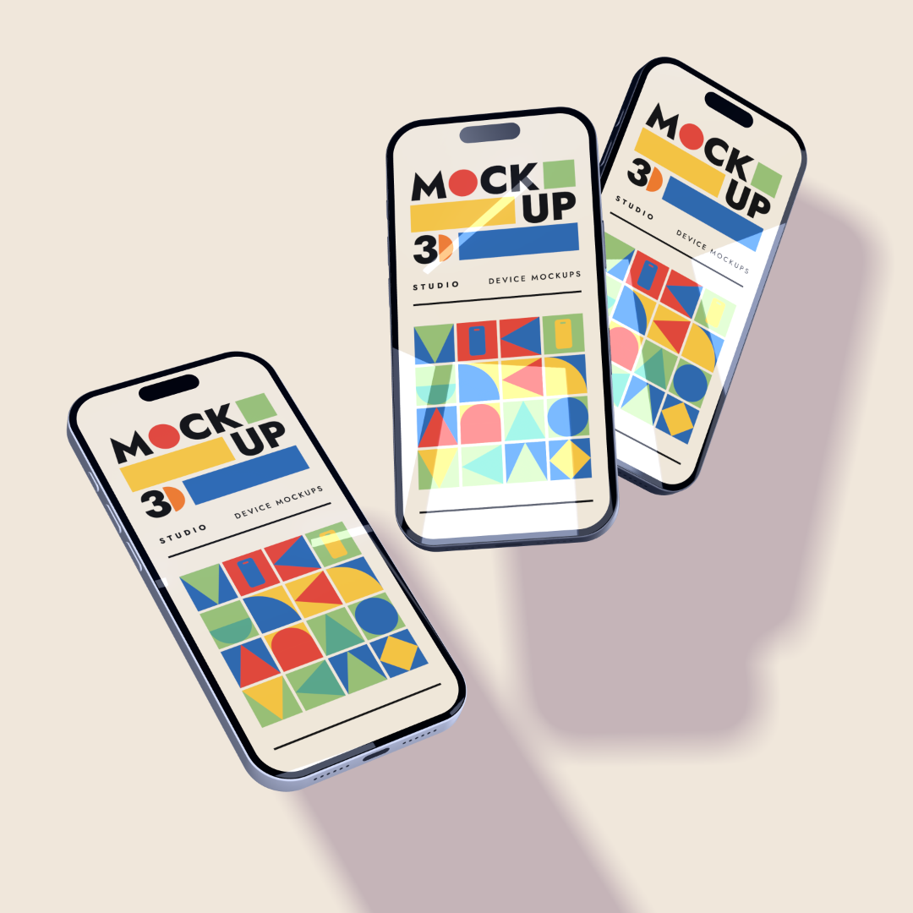
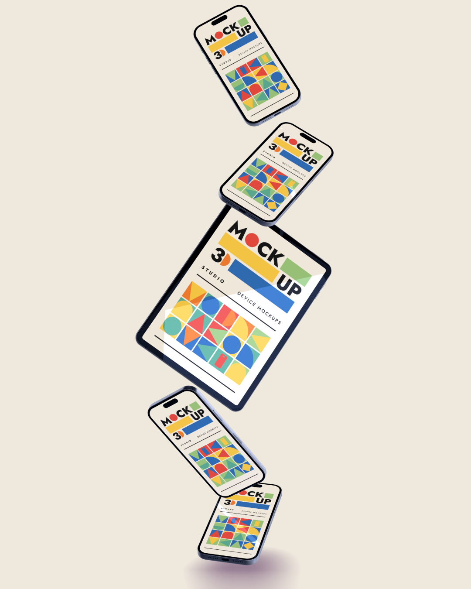
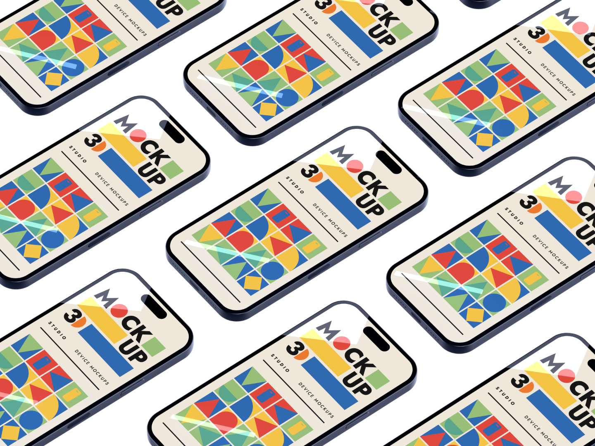
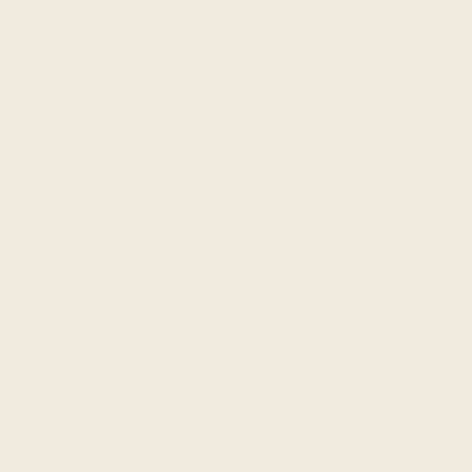
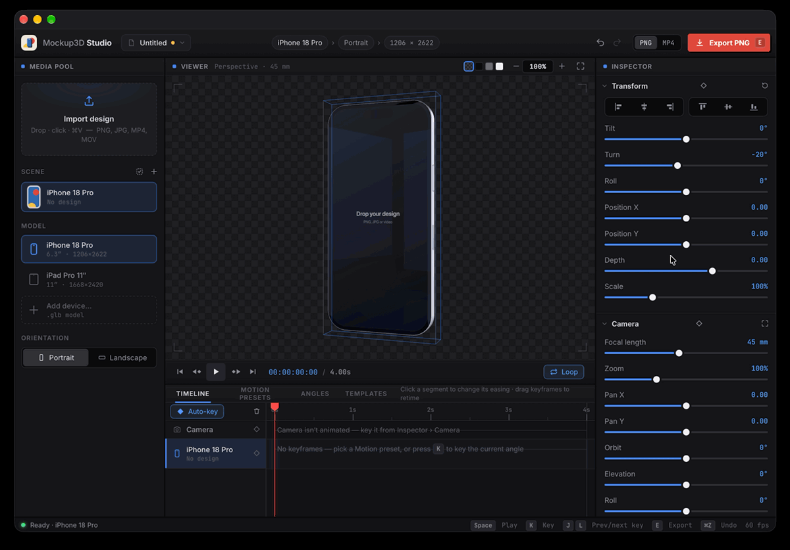
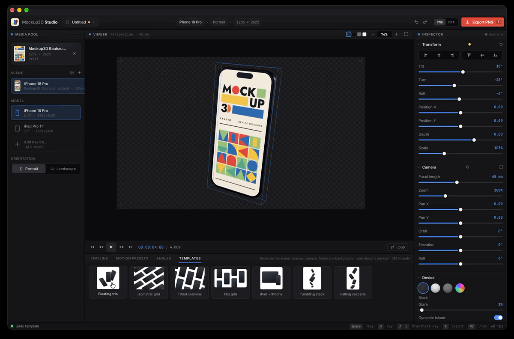
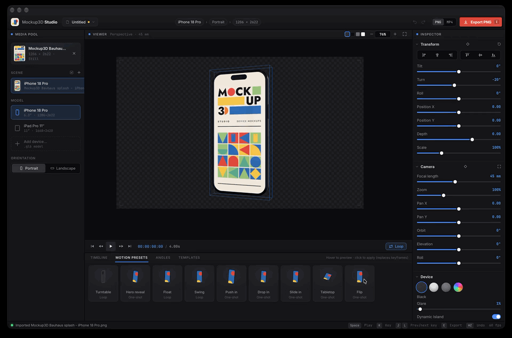
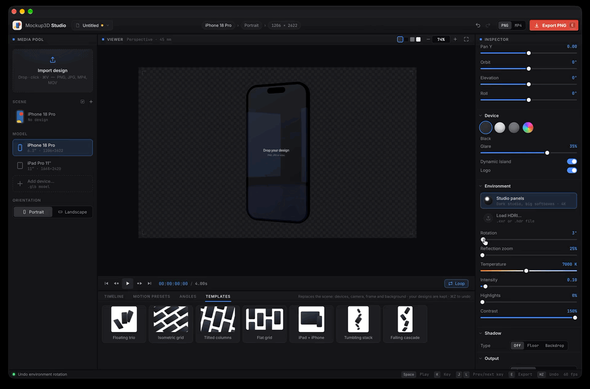

# Mockup3D Studio

Put your app designs on realistic 3D iPhones and iPads, or any other device you [add as a 3D model](#adding-your-own-device-models) (`.glb`), pose them, animate them, and export a still image or a video. It runs in your browser on your own computer (no hosting or account needed), works offline, and can be installed as an app.

Drop in a screenshot or a screen recording, choose an angle (or a whole animation) with one click, and export a PNG (transparent if you like) or an MP4.

<p align="center">
  
  
  
</p>
<p align="center">
  <a href="docs/media/animation.mp4"></a>
</p>

## Features

**Designs and devices**
- Built-in **iPhone 18 Pro** and **iPad Pro 11″** models, made from scratch to real dimensions.
- Designs can be images (PNG, JPG) or videos (MP4, MOV, including iPhone screen recordings). Videos play on the screen, in sync with the animation.
- Exact-size screenshots fill the screen pixel for pixel. Landscape designs turn the device to landscape automatically.
- Finishes: Black, Silver, Grey or any **custom colour**. Dynamic Island and the back logo can be turned on or off.
- **Import your own `.glb` models**, such as other phones, tablets or laptops. The app finds the screen itself or lets you click it. Compressed models open too.

**Scenes**
- Up to **12 devices** in one scene, each with its own design, model, finish and animation.
- **Templates**: complete ready-made scenes on white (Floating trio, Isometric grid, Tilted columns, Flat grid, iPad + iPhone, Tumbling stack, Falling cascade). Your designs fill every device.
- One-click **angles**: Front, Left, Right, Hero, Lean back, Tabletop, Isometric, Float, Side, Back.
- Drag to rotate, Shift-drag to move, and align buttons to snap a device to the edges of the frame.
- **Select several devices**, on the canvas or in the Scene list, and change their model, orientation, finish, shadow or design all at once.

**Look and lighting**
- Lit by a studio **HDRI** (dark studio with big softboxes), or load your own `.exr` / `.hdr`.
- Adjust the lighting's rotation, temperature, intensity, highlights and contrast.
- Soft **shadows** on a floor under the devices or a backdrop behind them, from crisp to very diffuse, kept in transparent PNGs. Turn the shadow off for any device.
- Real **screen glass** with mirror-like reflections. Set how strong they are (Glare) and how magnified (Reflection zoom).
- A camera with focal length, zoom, pan and orbit: move it around the scene, look down from above, or roll the frame.

**Animation**
- One-click **motion presets**: Turntable, Hero reveal, Float, Swing, Push in, Drop in, Slide in, Tabletop, Flip. Apply them to one device or to all of them, one after another.
- A **timeline** with a camera track and a track per device: keyframes, Auto-key, copy and paste, and an easing editor with presets and custom curves.
- Any length, frame rates from 1 to 240 fps, loop on or off.

**Export**
- **PNG**: transparent, solid colour, gradient or HDRI background, up to 8192 px, with anti-aliasing and optional trimming.
- **MP4** (H.264): rendered frame by frame, so it's smooth whatever your computer's speed.
- **PNG sequence**: every frame of the animation as a PNG in a .zip, transparency kept, for a transparent animation in a video editor.
- Frames for every platform: 9:16, 16:9, 1:1, 4:5, the viewer's shape, or any custom size.

**Projects and app**
- Save everything, including designs, imported models and a custom HDRI, as a single `.m3d` file.
- Undo and redo for everything, with keyboard shortcuts throughout.
- **Install it as an app** (Chrome, Edge, Safari). It works offline after the first visit.

## Contents

- [Getting started](#getting-started)
  - [Run it](#run-it)
  - [Install it as an app](#install-it-as-an-app)
  - [Your first mockup](#your-first-mockup)
  - [The window](#the-window)
- [Instructions](#instructions)
  - [Designs](#designs)
  - [Devices and the scene](#devices-and-the-scene)
  - [Posing and arranging](#posing-and-arranging)
  - [Camera and canvas](#camera-and-canvas)
  - [Device look](#device-look)
  - [Shadow](#shadow)
  - [Environment (lighting)](#environment-lighting)
  - [Animation](#animation)
  - [Export](#export)
  - [Projects](#projects)
  - [Adding your own device models](#adding-your-own-device-models)
  - [Shortcuts](#shortcuts)
- [For developers](#for-developers)
  - [Publishing](#publishing)
  - [Code layout](#code-layout)
  - [Devices](#devices)
  - [Rebuilding the models and the HDRI](#rebuilding-the-models-and-the-hdri)
- [Licence](#licence)

---

# Getting started

## Run it

It runs on your own computer: you don't need to host it anywhere. Get a copy with git, so you can update it later with `git pull` (downloading the ZIP works too, but won't tell you about updates). Put it somewhere you'll keep, such as Documents, rather than Downloads: this folder is the app.

```bash
cd ~/Documents
git clone https://github.com/thebigskyz/mockup3d-studio.git
```

Then start it from that folder:

```bash
cd mockup3d-studio
python3 serve.py
```

Then open http://localhost:5173. That small local server is all it needs (browsers won't load the 3D models from `file://`). There's nothing to install and no build step. You need Python 3: on a Mac, macOS offers to install it the first time you run `python3`; on Windows, get it from python.org. The first run needs internet to fetch Three.js from a CDN. Your designs never leave your computer.

## Install it as an app

Mockup3D Studio is a PWA (progressive web app), so you can install it straight from your local copy. No website needed. With `serve.py` running, open http://localhost:5173 and install it as below. It then opens in its own window from the Dock or Start menu.

After that first visit the app keeps a copy of everything it needs (about 13 MB, mostly the HDRI), so it opens and works even when `serve.py` isn't running, and offline.

- **Chrome / Edge:** click **Install app** at the top of the window (or the install icon in the address bar).
- **Safari on a Mac** (macOS Sonoma or later): **File → Add to Dock**. The Install app button explains this.
- **Safari on iPad:** **Share → Add to Home Screen**. An iPad can't use your computer's `localhost`, so this needs the app on a website (see [Publishing](#publishing)). The app is laid out for a large screen, so a Mac or PC is best.
- Firefox can't install web apps. It runs the app in a normal tab.

**Where things are once it's installed.** Installing doesn't copy or move your folder. There are three pieces:

| What | Where | What it is |
|---|---|---|
| **Your folder** | wherever you cloned it | The app's files. `serve.py` runs here and `git pull` updates them. The only copy you manage. |
| **A launcher** | Safari: `~/Applications`. Chrome: `~/Applications/Chrome Apps` | A shortcut that opens `http://localhost:5173` in its own window. It holds none of the app's files. |
| **A saved copy** | inside the browser's own storage | About 13 MB the browser keeps so the app opens without `serve.py` and offline. You don't manage it as files. |

- **Moving the folder later is fine.** The launcher points at `localhost:5173`, not at a folder. Run `serve.py` from the new place.
- **The port matters.** The installed app belongs to `localhost:5173`. If that port is busy, `serve.py` uses the next free one (5174…), which the installed app doesn't see, so it keeps using its saved copy. Close whatever is using 5173 and start `serve.py` again.

**Updating:** if you cloned the repo with git, the app tells you when GitHub has a newer version. A notice appears in the status bar: run `git pull` in the app's folder, then reload. To check, the app asks GitHub at most once a day (sending only which commit you're on), and only while `serve.py` is running. Click the notice to see what's new, or × to hide it until there's more.

An installed app picks up new files each time it opens. When it can't reach them (`serve.py` isn't running, or you're offline), it uses its saved copy. So after you pull, run `python3 serve.py` and open the app once.

## Your first mockup

1. **Drop a screenshot** anywhere in the window. It goes on the device's screen.

   

2. **Pick a template** in the **Templates** tab at the bottom for a complete scene, or an angle in the **Angles** tab (or drag the device to turn it).

   

3. **Choose a frame** in Inspector › **Output**, such as 9:16 for a story or 1:1 for a post, and a **Background**.
4. Click **Export PNG**.

For a video instead, pick a move in the **Motion presets** tab, switch the format next to the Export button to **MP4**, and export.



## The window

| Area | Where | What it's for |
|---|---|---|
| **Top bar** | top | Project menu (New, Open, Save), undo / redo, Install app, the PNG / MP4 / PNG seq switch and **Export** |
| **Media Pool** | left | The design drop zone, the **Scene** list of devices, the **Model** list and **Orientation** |
| **Viewer** | centre | The live preview. Its header has the preview background squares and the canvas zoom. Below it is the transport: play, time, duration, Loop |
| **Bottom panel** | bottom | Tabs for **Timeline**, **Motion presets**, **Angles** and **Templates**. Drag its top edge to resize it |
| **Inspector** | right | Settings for the selected device and the scene: Transform, Camera, Device, Environment, Shadow, Output |
| **Status bar** | bottom edge | What just happened, common shortcuts and the preview frame rate |

**Inspector values:** drag a blue value left or right to scrub it (hold Shift for faster, Alt for finer), or click it to type a number. Double-click the Temperature, Highlights, Contrast or Reflection zoom slider to reset it.

---

# Instructions

## Designs

- **Add a design:** drop a file anywhere in the window, click the drop zone, or paste with ⌘V. It goes on the selected device. To put it on a particular device, drop it onto that device in the viewer, or onto its row in the Scene list.
- **Formats:** PNG, JPG and other images, or MP4 / MOV videos (including iPhone HEVC screen recordings).
- **Sizes:** exact-size screenshots fill the screen exactly (1206 × 2622 for the iPhone 18 Pro, 1668 × 2420 for the iPad Pro 11″). Other sizes are scaled to fill the screen and cropped.
- **Landscape** designs switch the device to landscape automatically. You can also switch it with **Orientation** in the Media Pool.
- **Videos** play in sync with the timeline and loop if they're shorter. If you haven't added keyframes yet, the timeline takes the video's length. Each device can play its own video.
- **Remove a design** with the × on its clip in the drop zone.

## Devices and the scene

The **Scene** list in the Media Pool shows the devices in the scene (up to 12).

- **+** adds a device like the selected one, in the same spot, stacked just in front of it. **Shift-drag** it (or use Position X / Y) to move it where you want. The camera and the other devices don't move. Hover a row for **Duplicate** (which copies the design and animation too) and **Delete**. To fit everything in view, use the frame button in Inspector › Camera.
- **Select a device** by clicking its row, clicking it in the viewer, clicking its timeline track, or with **Tab** / **Shift-Tab**. The selected device has a blue outline in the viewer, which is never exported. Click empty canvas (or press **Esc**) to deselect and hide the outline.
- **Select several:**
  - **On the canvas:** ⌘-click (Ctrl-click) or Shift-click a device to add it to the selection or take it out. Shift-*dragging* still moves a device.
  - **In the Scene list:** ⌘-click rows to add or remove devices, or Shift-click to select a run of them.
  - **⌘A** (or the select-all button next to **+**) selects every device.

  All of them get the blue outline. Then these change every selected device at once:
  - **Model**: e.g. switch every phone to an iPad, or to an imported model.
  - **Orientation**, **Finish** (including a custom colour), **Dynamic Island**, **Logo** and whether it casts a **Shadow**.
  - **A new design**: dropped on the drop zone or the window, chosen with the drop zone, or pasted. Dropping onto one device still puts it on just that one.
  - **Delete**.
  - Transform, Angles and Motion presets still act on the main selected device (the one the Inspector shows). Motion presets have their own **Apply to: All devices**.
- **Delete** (or Backspace) deletes the selected device, or all the selected devices. ⌘Z brings them back.
- **Model:** the Model list switches the selected device between the iPhone 18 Pro, the iPad Pro 11″ and any models you've imported.
- Each device has its own design, model, orientation, finish, Dynamic Island, logo, shadow on or off, position and animation. The design drop zone, Transform values, Angles and Motion presets all apply to the selected device.
- The environment, glare, background, camera and timeline length are shared by the whole scene.

## Posing and arranging

- **Rotate:** drag the device in the viewer.
- **Move:** **Shift-drag** the device. It moves across the screen, whichever way the camera is orbited.
- **Angles** tab: one click sets a ready-made angle on the selected device: Front, Left, Right, Hero, Lean back, Tabletop, Isometric, Float, Side or Back. **R** resets the angle.
- **Mirror** (right of the Motion presets, Angles and Templates tabs): flips them left to right, so Hero turns the other way, Slide in comes from the right and Turntable spins the other way. A mirrored template also puts its devices on the other sides and mirrors its camera, lighting and gradient. The cards flip too, so they show what you'll get. It stays on until you turn it off.
- **Transform** (Inspector): exact values for Tilt / Turn / Roll, Position X / Y, **Depth** (towards or away from the camera) and **Scale**.
- **Align:** the buttons at the top of Transform line the selected device up with the canvas: left, centre or right edge, and top, middle or bottom edge. They use the device's actual outline on screen, so a tilted device's corner touches the edge. They only change the device's position, so they key like any other move.
- **Templates** tab: complete scenes to start from, all on a white background (change it in Output › Background). Each one sets the devices and their models, poses and finish, the camera angle and lens, the frame shape, the background and the shadow, and sometimes the lighting rotation.
  - **Floating trio** (1:1): three phones floating at different angles.
  - **Isometric grid** (4:3): phones lying flat, seen from above at an angle, filling the frame edge to edge (only the 11 that show are added).
  - **Tilted columns** (4:3): phones in columns at uneven heights, with the whole frame tilted, filling it edge to edge (only the 11 that show are added).
  - **Flat grid** (16:9): six phones straight on, like a print layout.
  - **iPad + iPhone** (1:1): a landscape iPad with an iPhone in front of its corner.
  - **Tumbling stack** (4:5): an iPad in mid-air with phones above and below it.
  - **Falling cascade** (9:16): four phones falling in a zig-zag.
  - Your devices are reused in order and keep their designs. Devices without a design show the scene's designs in turn, so one screenshot fills a whole grid. Drop a different design on each device afterwards.
  - Applying a template clears the keyframes. ⌘Z undoes the whole template in one step.
  - Frame shapes other than the built-in ones (such as 4:3) use a Custom canvas.

## Camera and canvas

**Camera** (Inspector): the camera is shared by every device and can be animated on its own track.

- **Focal length** changes the perspective. A long lens looks flatter, a short one more dramatic.
- **Zoom** and **Pan X / Y** frame the shot. Pan moves across and up the screen, whichever way the camera faces.
  - Zoom goes from 10% to 1000%. It moves the camera in, and once the camera reaches the nearest device it stops just in front of it and magnifies instead, so you can zoom right into a detail without going through the device.
- **Orbit** swings the camera around the scene, **Elevation** raises it to look down (or lowers it to look up), and **Roll** tilts the whole frame. Double-click a slider to straighten it. Option-drag (Alt-drag) in the viewer orbits the camera: across for Orbit, up and down for Elevation.
  - Orbiting the camera turns every device at once, and the lighting and reflections stay put in the room, as with a real camera. To turn one device, use its Transform instead.
  - Angles and Transform rotations stay relative to the room, so **Front** faces the camera only when Orbit and Elevation are 0°.
- The frame button in the Camera header zooms and pans so every device is in view.

**Canvas zoom** only changes your view, never the export:

- **Scroll** or pinch over the viewer to zoom in and out around the pointer.
- Hold **Space and drag** (or middle-drag) to pan. A quick tap of Space still plays and pauses.
- The zoom box in the viewer header has −/+ buttons and a menu: Fit, 25%–400%, or type a **Custom** percentage.
- With a fixed frame (9:16, 1:1, Custom…), 100% shows the export at its real pixel size.
- **⌘+ / ⌘−** step the zoom, **⌘0** (or **F**) fits, and **⌘1** is 100%.

**Viewer background:** the four squares in the viewer header change what shows behind transparent areas: checkerboard, dark, grey or light. This is for the preview only. The export uses Output › Background.

## Device look

Inspector › **Device** sets how the selected device looks:

- **Finish** (per device): Black, Silver or Grey, or the colour swatch for any **custom colour**.
- **Glare** sets how reflective the front glass is, seen straight on. Real glass is about 4%; new scenes start at 1%, so designs show almost untouched. The glass reflects the environment sharply, like a mirror, and more strongly at steep angles, so the HDRI's bright parts (the softboxes in Studio panels) show as crisp highlights. Turn **Environment › Rotation** to move the reflection across the screen. Set Glare to 0 to get the design's exact colours.
- **Dynamic Island** shows or hides the iPhone's island (per device).
- **Logo** shows or hides the logo on the back (per device). On the iPhone it sits on the MagSafe panel, a slightly lighter frosted window below the camera bar.

## Shadow

Inspector › **Shadow** adds a soft shadow, cast by light from above and to one side:

- **Type:** **Off**, **Floor** (on the ground under the lowest device) or **Backdrop** (on a wall just behind the devices, facing the camera).
  - Backdrop suits devices facing you, like a grid on a coloured background.
  - Floor suits floating or lying-down devices. The camera has to look down on it a little: with Camera › Elevation at 0° the floor is edge-on and its shadow can't be seen, and the Inspector says so.
- **Colour** tints the shadow, for example a deep purple on a purple background so it looks like part of the scene. Double-click the swatch for black.
- **Strength** is how dark the shadow is. **Softness** blurs its edges, from crisp at 0% to a wide, diffuse pool at 100%. The blur is the same size however big or spread out the scene is.
- **Distance** is the gap between the devices and the floor or backdrop. Further away gives a bigger, softer-looking, more offset shadow, so devices look like they're floating. Near 0, devices sit right on the floor.
- **Offset** is how far the shadow shifts away from the devices. At 0% it sits directly behind them (or straight under them on a floor): with some Softness and Distance that gives a soft halo all round. Higher offsets give a classic drop shadow.
- **Light angle** sets which way the shadow shifts, as seen through the camera: 0° is light from above (shadow below), negative from the left, positive from the right.
- **Cast by this device** (with more than one device): untick it to leave the selected device without a shadow, while the others keep theirs. Select several devices first to switch them all; a half-way switch means some of them cast one and some don't, and clicking it turns the shadow on for all of them. The Scene list marks devices without a shadow with "no shadow".
- Double-click a slider to reset it.

The floor or backdrop itself is invisible: only the shadow shows, so it works on any background. Transparent PNGs keep it as a soft, semi-transparent grey. Shadows follow devices as they move, in the preview and in exports. Every template comes with a shadow that suits it.

## Environment (lighting)

The Environment section chooses what lights the device and shows in its reflections:

- **Studio panels** (the default): a dark photo studio with three big softbox panels in front of the device and white flats at the sides. No windows. High contrast, with crisp white highlights on the glass and frame.
- **Load HDRI…**, or dropping a `.exr` / `.hdr` file anywhere, uses your own. It isn't remembered after a reload unless you save a project.
- **Rotation** spins the lighting.
- **Reflection zoom** sets how magnified the glass reflection is. Lower shows more of the room, higher zooms into it. Double-click to reset it to 100%. The reflection keeps the same scale whatever the focal length and camera zoom, so a long lens doesn't turn it into a blurry, blocky patch.



- **Temperature** warms (lower K) or cools (higher K) the lighting, reflections and HDRI background. 6500 K leaves the HDRI's own colours.
- **Intensity** sets how brightly it lights the device. An HDRI background keeps its own brightness.
- **Highlights** sets how bright the brightest parts of the HDRI stay, such as softboxes. They cause the white glare and most of the light. 100% leaves them as they are. Lower tames that whiteness without darkening the whole scene the way Intensity does.
- **Contrast** makes the lighting softer (below 100%) or punchier (above 100%).
- **New scenes start with** Rotation 35°, Reflection zoom 33%, 7000 K, Intensity 0.70, Highlights 72% and Contrast 150%. Double-clicking a slider sets it back to neutral (6500 K, 100%), not to these.
- To show the HDRI behind the device, set Output › Background to **HDRI**. **Background focus** at 100% (the default) is the sharpest; lower it to throw the background out of focus.

## Animation

**Motion presets** tab: one-click moves: Turntable, Hero reveal, Float, Swing, Push in, Drop in, Slide in, Tabletop and Flip.

- Hover a card to preview it; click to apply it.
- Applying one replaces the device's keyframes and fits them to the current duration.
- Moves start from where the device is, so they work with any arrangement.
- **Apply to: All devices** applies the preset to every device. One-shot moves (such as Drop in) then start one after another.
- **Mirror** flips the move left to right (see Posing and arranging).

**Timeline** tab: there's a **Camera** track, then a track per device with its design underneath. Tracks show keyframes (◆). Between keyframes are segments labelled with their easing.

- Click or drag on the ruler to move the playhead. The Inspector always shows the pose at the playhead.
- Click a keyframe to select it. **Shift-click** (or ⌘-click) to select several.
- Drag to retime the selection, Alt-drag to duplicate it, and Delete removes it.
- **⌘C** copies the selected keyframes (or the selected device's keyframe at the playhead). **⌘V** pastes them at the playhead, keeping their spacing and easing.
  - Device keyframes paste onto the selected device, so you can copy one device's motion to another. Camera keyframes paste onto the camera.
  - The copy also goes onto the system clipboard, so you can paste into another project or tab.
- Click a segment to open the **easing editor**:
  - **Presets:** Linear, Ease in, Ease out, Ease in-out, Smooth, Back (overshoot), Spring or Hold.
  - **Custom curve:** drag the yellow handles on the graph (time across, value up). With just the two ends you can also type exact `x1 y1 x2 y2` values. These are the same numbers as a CSS `cubic-bezier()`, so you can paste curves from other tools.
  - **More points** (it works like Figma): click the line to add a point, where the curve keeps its shape, and drag straight away to place it. Click a point to select it and show its handles; press **Delete** or Backspace to remove it. You can have up to three points between the two ends. A point's two handles stay in line for a smooth curve; Alt-drag one to bend just that side.
  - **Spring** opens with a point at each bounce, so you can make one bounce bigger, flatten another or delete one without losing the rest. Click the Spring preset to get the original back.
  - Raising a handle above the top of the box makes the motion overshoot and settle back.
  - A dot traces the curve and a ball previews the motion.

**Keyframing:**

- Press **K** (or the ◆ button on a track or in the Inspector) to add or remove a keyframe at the playhead for the selected device. The camera has its own ◆ (Inspector › Camera, or its track).
- With **Auto-key** on, changing a device (or the camera) whose track already has keyframes records a keyframe at the playhead. Dragging, Inspector values and Angles all count.
- **Clear** (the bin icon) deletes all keyframes and keeps the current pose.

**Transport** (below the viewer):

- Play, go to start or end, jump between keyframes, and turn Loop on or off.
- **Duration:** drag or click the blue value. Changing it doesn't move keyframes. Keyframes past a shortened end are kept, shown as a "+N ▸" marker, and reappear if you lengthen the timeline again.
- **Frame rate** (Inspector › Output): pick 12, 15, 24, 25, 30, 48, 50, 60 or 120 fps, or choose **Custom…** to type any whole number from 1 to 240. Keyframes keep their times in seconds when you change it.

## Export

Choose **PNG**, **MP4** or **PNG seq** with the switch next to the **Export** button (or press **E**). Inspector › **Output** sets:

- **Frame:** Viewport, 9:16, 16:9, 1:1, 4:5 or **Custom**. The viewer reshapes to show exactly what will be exported.
  - **Custom** lets you type an exact canvas size in pixels (16–8192). The ↑ / ↓ keys step it by 1 (Shift: 10), and ⇄ swaps width and height.
- **Size:**
  - With the Viewport frame, PNG size is 1×, 2× or 4× the viewer.
  - With an aspect-ratio frame (and for MP4 and PNG sequences with the Viewport frame), you choose the short side: 720p, 1080p, 1440p or 4K.
  - With Custom, the canvas size is the export size.
- **Background:** None (transparent, the default; PNG and PNG sequence only), Solid, Gradient (two colours plus an angle), or HDRI (the environment image, with adjustable focus). MP4 can't be transparent, so switching to MP4 with None selected changes it to Solid.
- **Quality** (MP4 only): Standard or High.
- **Dithering** (MP4 only): faint noise that stops smooth gradients, such as a dark gradient background, showing visible steps (banding) after video compression.
  - **Off** is the cleanest, but gradients may band.
  - **Light** (the default) is barely visible.
  - **Medium** is stronger fine grain.
  - **Strong** is coarser grain. It's the safest against banding, especially in Safari, whose encoder smooths fine grain away, but you can see it.
- **Anti-alias:** exports are rendered 2× or 4× larger, then scaled down so the edges are smooth. 4× (the default) is the smoothest and adds about half a second per PNG. Off is fastest but shows jagged edges.
- **Trim empty space:** for transparent PNGs, crops to the devices plus a small margin. It's off by default, so the PNG is the whole canvas.

The selection outline and the viewer background never appear in exports.

**MP4 notes:**

- MP4 export renders every frame exactly, then encodes H.264 in the browser. It needs Chrome, Edge or Safari 16.4 or later.
- MP4 can't be transparent (H.264 has no transparency). For a transparent animation, export a PNG sequence instead.
- Design videos (MP4 or MOV) are decoded frame by frame during export, so long recordings export quickly. Formats the browser can't decode that way (such as WebM) fall back to a slower method.

**PNG sequence notes:**

- **PNG seq** renders every frame of the animation, as for MP4, and saves each as a PNG, with Background set to None for transparency. You get one .zip holding a folder of numbered frames (`…_0000.png`, `…_0001.png` …).
- Video editors import a numbered sequence as one clip: in After Effects or Premiere, import the first frame with *PNG Sequence* (*Image Sequence*) ticked; DaVinci Resolve's Media Pool shows the folder as one clip. Set the clip's frame rate to the timeline's fps if the editor asks.
- The frames are full-size and lossless, so the zip is large: roughly 10 MB a second at 1080p and 30 fps for a transparent background, more for HDRI backgrounds. Trim empty space doesn't apply (every frame has the same size).

## Projects

Use the project menu at the top left. It shows the project name, with an orange dot when there are unsaved changes.

- **Save** (⌘S) and **Save As…** (⇧⌘S) write a single `.m3d` file. It contains:
  - all your settings and the animation;
  - each device's design image or video;
  - any imported device models the scene uses;
  - a custom HDRI, if you loaded one.
- **Open…** (⌘O), or dropping a `.m3d` file onto the window, loads a project.
- **New project** starts over from the defaults.

In Chrome and Edge, Save writes straight back to the file you opened or saved. Safari can't do that, so there Save downloads a new copy, which goes to your Downloads folder.

Between visits, the app remembers your last settings and imported models in the browser. Designs (images and videos) are only kept in a saved project, so the app warns you before you close a tab with unsaved changes and a design loaded.

## Adding your own device models

Click **Add device…** at the bottom of the Model list, or drop a `.glb` file anywhere in the window. The model is saved in this browser, so it's still there next time. Your original file isn't changed. The Inspector then shows **Model setup**:

1. **Screen:** if a part is named like a screen ("Screen", "Display", "LCD"…), it's used automatically. Otherwise the app asks you to click the screen on the model (**Pick screen** does this again later).
   - If the screen is its own part, the whole part is used.
   - If the model is one piece, only the flat area around your click is used. It spreads across surfaces facing the same way and stops at edges, bevels and the rounded frame. A screen that's flush with its bezel, with no edge between them, takes the bezel too.
2. **Hide parts:** if a glass or cover layer sits over the display and hides your design, click **Hide parts**, then click that layer. **Show all** brings everything back.
3. **Rotate:** if the screen doesn't face you at the Front angle, use **X / Y / Z 90°** until it does, so the angle and motion presets look right.
4. **Name** renames it in the Model list. **Remove model**, or the × on its list item, deletes it from the browser.

Good to know:

- Your design is projected flat across the screen, so curved or wrap-around screens may stretch slightly at the edges.
- Imported screens get the same glass as the built-in models, so **Glare** and the HDRI reflection work on them too.
- **Finish colours** only work on imported models whose materials use the built-in names (`Frame`, `BackPanel`, `FrameAccent`).
- **Compressed models** open too: Draco or Meshopt geometry and KTX2 (Basis) textures, which many downloadable `.glb` files use. The decoders download the first time you open an imported model.
- **`.gltf` files** must be self-contained. Otherwise, export as `.glb` with textures embedded.

## Shortcuts

On Windows and Linux, use <kbd>Ctrl</kbd> wherever this says <kbd>⌘ Cmd</kbd>, and <kbd>Alt</kbd> for <kbd>⌥ Option</kbd>. Letter keys don't do anything while you're typing in a field.

### Turn and move devices · <kbd>Drag</kbd>

- **Drag** a device in the viewer to **turn** it. With only one device, you can drag anywhere.
- Hold <kbd>⇧ Shift</kbd> and **drag** a device to **move** it around the frame.
- Hold <kbd>⌥ Option</kbd> and **drag** to **orbit the camera** around the whole scene.
- <kbd>R</kbd> turns the selected device back to face you straight on.

### Select devices · <kbd>Click</kbd>

- **Click** a device in the viewer, or its row in the Scene list, to select it.
- **Click** empty space in the viewer, or press <kbd>Esc</kbd>, to deselect.
- <kbd>Tab</kbd> selects the next device, and <kbd>⇧ Shift</kbd> + <kbd>Tab</kbd> the previous one.
- <kbd>⌘ Cmd</kbd> + **click** a device, in the viewer or the Scene list, to add it to the selection or take it out.
- <kbd>⇧ Shift</kbd> + **click** does the same in the viewer. In the Scene list it selects every row from the selected device to this one.
- <kbd>⌘ Cmd</kbd> + <kbd>A</kbd> selects every device.
- <kbd>Delete</kbd> (or <kbd>Backspace</kbd>) deletes the selected devices, as long as no keyframes are selected. <kbd>⌘ Cmd</kbd> + <kbd>Z</kbd> brings them back.

### Play · <kbd>Space</kbd>

- <kbd>Space</kbd> plays or pauses.
- <kbd>←</kbd> and <kbd>→</kbd> step back or forward one frame. Hold <kbd>⇧ Shift</kbd> to step 10 frames.
- <kbd>Home</kbd> and <kbd>End</kbd> go to the start and the end.
- <kbd>J</kbd> and <kbd>L</kbd> jump to the previous and the next keyframe.

### Keyframes · <kbd>K</kbd>

- <kbd>K</kbd> adds a keyframe for the selected device at the playhead, or removes the one that's there.
- **Click** a keyframe in the timeline to select it. <kbd>⇧ Shift</kbd> + **click** or <kbd>⌘ Cmd</kbd> + **click** selects more on the same track.
- **Drag** keyframes to move them in time. Hold <kbd>⌥ Option</kbd> as you start dragging to drag copies and leave the originals where they are.
- <kbd>⌘ Cmd</kbd> + <kbd>C</kbd> copies the selected keyframes (with none selected: the selected device's keyframe at the playhead).
- <kbd>⌘ Cmd</kbd> + <kbd>V</kbd> pastes them at the playhead, keeping their spacing and easing.
- <kbd>Delete</kbd> (or <kbd>Backspace</kbd>) deletes the selected keyframes.

### Zoom and pan the canvas · <kbd>Scroll</kbd>

These change only how big you see the frame, not the export.

- **Scroll** or **pinch** over the viewer to zoom in and out around the pointer.
- Hold <kbd>Space</kbd> and **drag** to pan. (A quick tap of Space plays instead.)
- <kbd>⌘ Cmd</kbd> + <kbd>+</kbd> and <kbd>⌘ Cmd</kbd> + <kbd>−</kbd> zoom in and out in steps.
- <kbd>F</kbd> or <kbd>⌘ Cmd</kbd> + <kbd>0</kbd> fits the frame in the viewer.
- <kbd>⌘ Cmd</kbd> + <kbd>1</kbd> shows it at 100%.

### Change Inspector values · <kbd>Drag</kbd>

- **Drag** a blue value left or right to change it. Hold <kbd>⇧ Shift</kbd> to change it 10× faster, or <kbd>⌥ Option</kbd> for 10× finer steps.
- **Click** a blue value to type a number, then press <kbd>Enter</kbd> to use it or <kbd>Esc</kbd> to cancel.
- **Double-click** a slider in Camera, Environment or Shadow to reset it. Double-click the shadow colour to go back to black.
- In Output's **Width** and **Height**, <kbd>↑</kbd> and <kbd>↓</kbd> change the size by 1 px. Hold <kbd>⇧ Shift</kbd> for 10 px.

### Files, undo and export · <kbd>E</kbd>

- <kbd>E</kbd> exports a PNG, an MP4 or a PNG sequence, whichever is chosen next to the Export button. <kbd>Esc</kbd> cancels an export that's running.
- <kbd>⌘ Cmd</kbd> + <kbd>Z</kbd> undoes.
- <kbd>⇧ Shift</kbd> + <kbd>⌘ Cmd</kbd> + <kbd>Z</kbd>, or <kbd>⌘ Cmd</kbd> + <kbd>Y</kbd>, redoes.
- <kbd>⌘ Cmd</kbd> + <kbd>S</kbd> saves the project, and <kbd>⇧ Shift</kbd> + <kbd>⌘ Cmd</kbd> + <kbd>S</kbd> is Save As.
- <kbd>⌘ Cmd</kbd> + <kbd>O</kbd> opens a project.
- <kbd>⌘ Cmd</kbd> + <kbd>V</kbd> with an image or a video copied puts it on the selected device's screen.

---

# For developers

## Publishing

You only need this to share the app with others by link, or to install it on an iPad. On your own computer, [running it locally](#run-it) is enough.

**GitHub Pages** (free for public repos): push the repo to GitHub, then in the repo's **Settings → Pages** choose *Deploy from a branch*, branch `main`, folder `/ (root)`. A minute later it's live at `https://<your-name>.github.io/<repo-name>/`; share that link. Installing needs HTTPS, which Pages provides (or `localhost` while testing).

**README media** live in `docs/media/` (the screenshots and video at the top of this file, and the screen recordings in Your first mockup and Environment). They aren't part of the app, so they're not in `sw.js`. GitHub won't play a video stored in the repo inside the README, so videos are shown as GIFs: `animation.gif` is made from `animation.mp4` (600 px, 20 fps) and links to it; `drop-your-design.gif`, `templates.gif`, `motion-preset.gif` and `hdri-rotate-zoom.gif` are screen recordings of the app (1200 px wide, 15 fps).

## Code layout

Plain JavaScript modules, no build step. `js/main.js` starts the app; the parts it's made of are in `js/app/`, one file per area:

| File | What it does |
|---|---|
| `state.js` | Settings saved in the browser, their defaults, upgrading older ones, and the animation |
| `history.js` | Saving settings, and undo / redo |
| `ctx.js`, `instances.js` | The 3D scene, and each device in it (its model, design and live pose) |
| `animation.js` | Poses, keyframes, playback, aligning and angle animations |
| `designs.js`, `clipboard.js` | Designs on the devices (drop, paste, videos); copying and pasting keyframes |
| `scene-list.js` | The Scene list and selecting devices |
| `viewer.js` | Dragging in the viewer, orbiting, and the canvas zoom |
| `params.js`, `controls.js`, `ui-sync.js` | Inspector values; wiring up the controls; keeping the UI in step with the state |
| `presets.js`, `scene-templates.js` | Angle and motion presets; templates |
| `transport.js`, `timeline-panel.js` | Play controls and timecode; the timeline panel |
| `environment.js`, `models.js` | HDRI lighting and the background; imported device models |
| `projects.js`, `export.js` | `.m3d` projects; PNG, MP4 and PNG sequence export |
| `keyboard.js`, `status.js`, `util.js` | Shortcuts, the status bar, small helpers |

The rest of `js/` holds the lower-level pieces they use: the renderer (`scene.js`), device models (`devices.js`, `custom-devices.js`), keyframes and easing (`timeline.js`, `easing.js`, `timeline-ui.js`), and exporting and file formats.

**Adding files:** `sw.js` saves a fixed list of files for offline use (`APP_FILES` and `CDN_FILES`). When you add a new file the app loads, such as a new JS module, model or HDRI, add it there too. Otherwise the app still works online, but that file is missing offline.

## Devices

Every model and the bundled HDRI are made by this project's own Blender scripts, from scratch. No third-party 3D assets are used, so there is nothing to credit.

| Device | Size (mm) | Screen (px) |
|---|---|---|
| iPhone 18 Pro | 71.9 × 150.0 × 8.75 | 1206 × 2622 |
| iPad Pro 11″ | 177.5 × 249.7 × 5.3 | 1668 × 2420 |

## Rebuilding the models and the HDRI

All models come from one Blender script:

```bash
/Applications/Blender.app/Contents/MacOS/Blender -b -P blender/build_devices.py
```

The script writes `models/*.glb` (loaded by the app) and `blender/devices.blend` (every device, for editing by hand). Device sizes, screen resolutions and corner radii are in the spec tables at the top of the script.

The HDRI comes from another script. It takes about 5 minutes on an Apple-silicon GPU; add `-- studio-panels 1024 32` for a quick low-quality test:

```bash
/Applications/Blender.app/Contents/MacOS/Blender -b -P blender/build_hdri.py
```

It builds the studio, renders it as a 360° panorama and writes `env/studio-panels.exr`. The softbox positions and light strengths are in `build_studio_panels()`.

If you change a model by hand, keep these names, which the app relies on:

| Name | Kind | What the app does with it |
|---|---|---|
| `Screen` | material | Replaced with your design. The mesh's UVs span the whole display, 0–1. |
| `Glass` | material | The glare layer. |
| `IslandBlack` | material | The Dynamic Island toggle. |
| `Logo` | material | The Logo toggle; coloured like the back. |
| `BackGlass` | material | The iPhone's MagSafe panel; a slightly lighter shade of the back. |
| `Frame`, `BackPanel`, `FrameAccent` | materials | Recoloured by the finish swatches. |
| `screenW`, `screenH` | custom properties on the root object (metres) | Used to fit the design. |

A `.001`-style suffix on any of these names is fine.

---

# Licence

MIT, see [LICENSE](LICENSE). The device models, the HDRI and the artwork in this repo were all made for it.

iPhone, iPad and the Apple logo are trademarks of Apple Inc. This project isn't affiliated with or endorsed by Apple.
